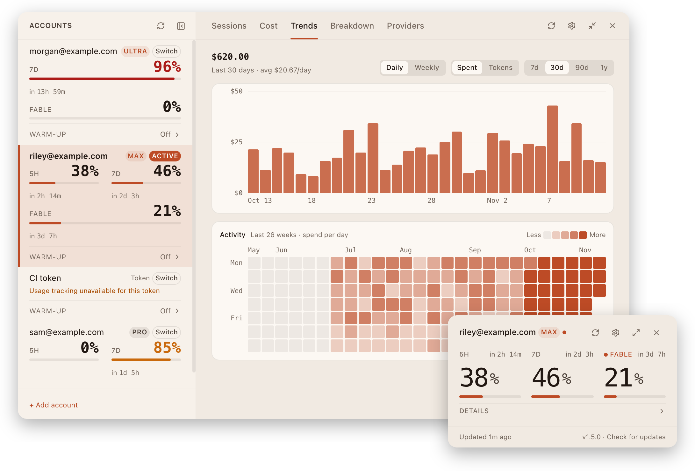
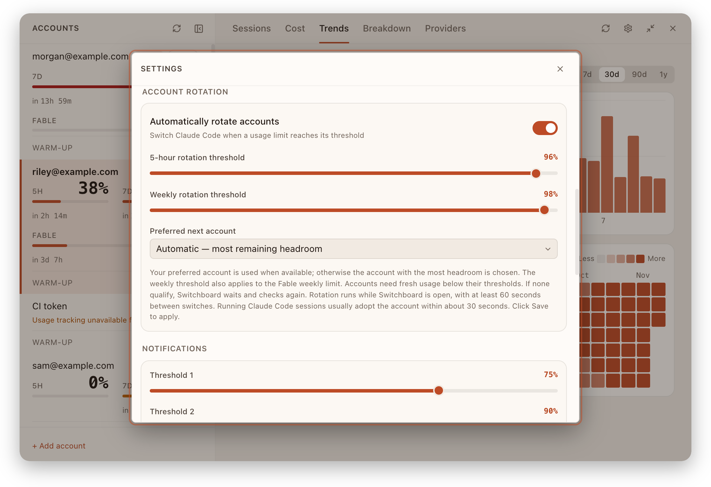
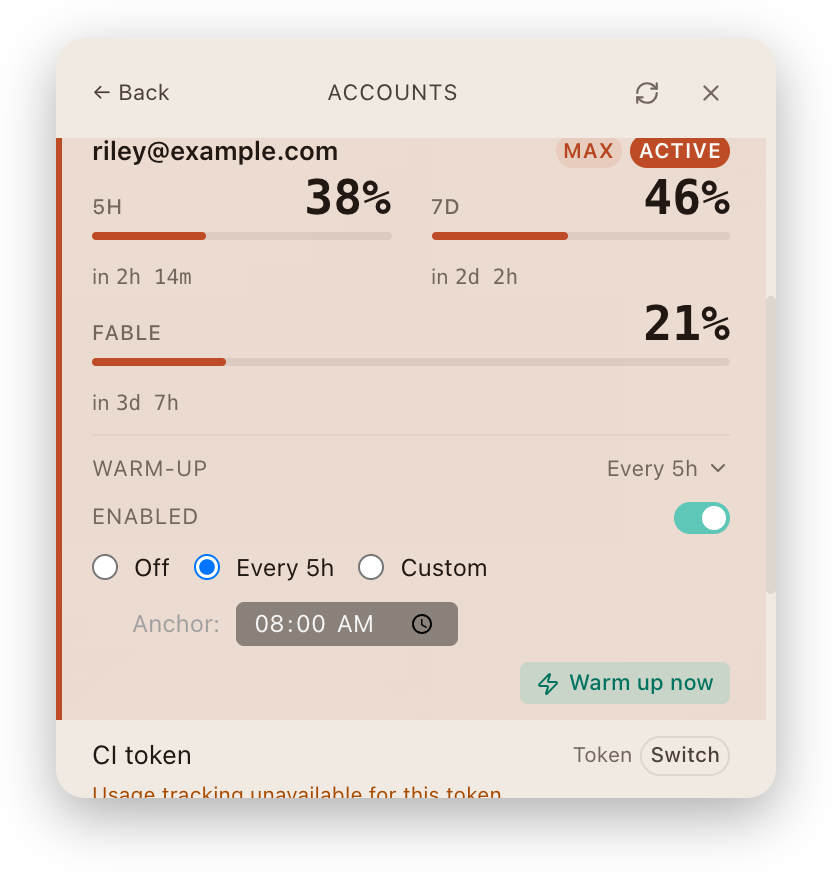
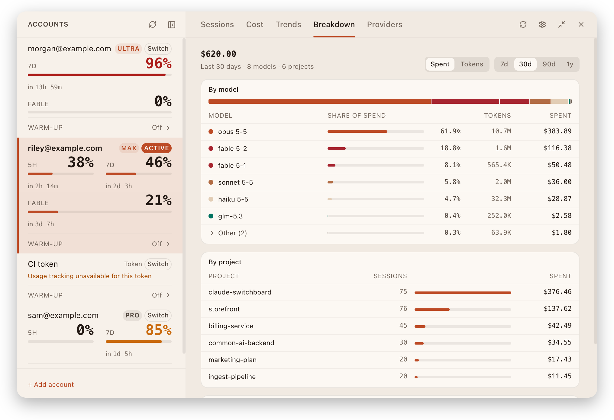
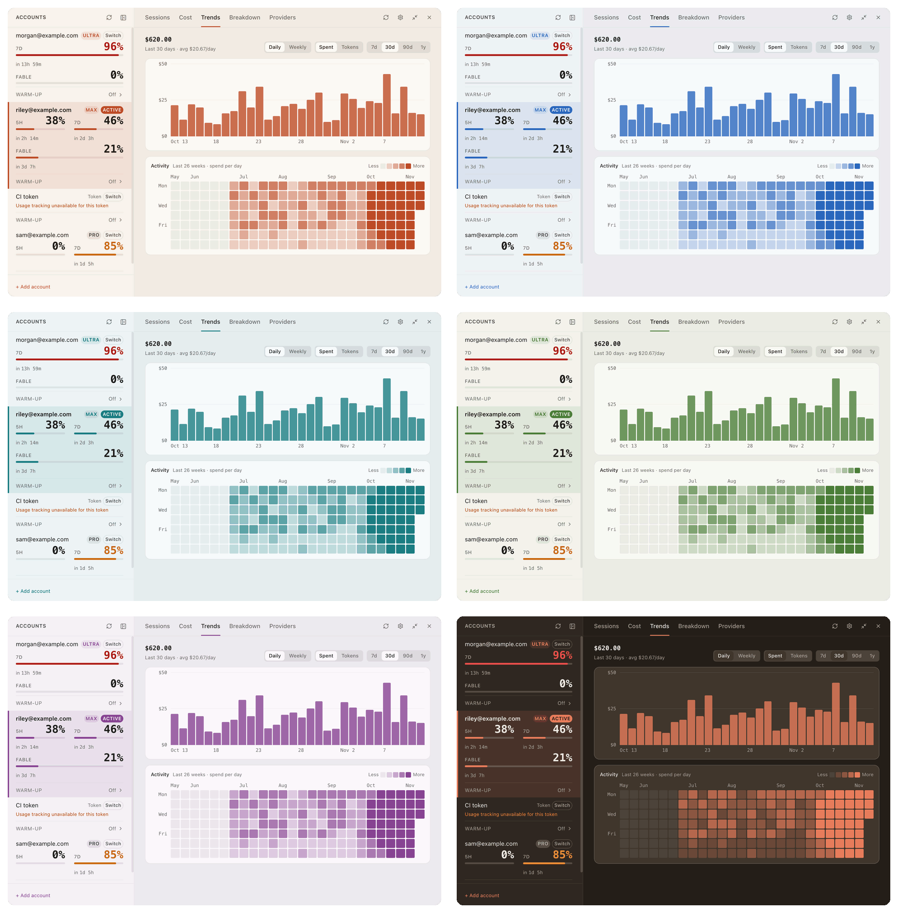
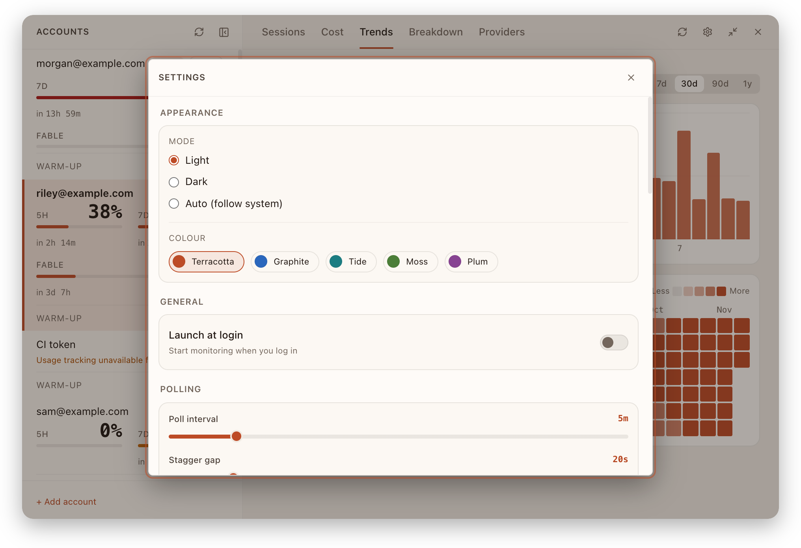
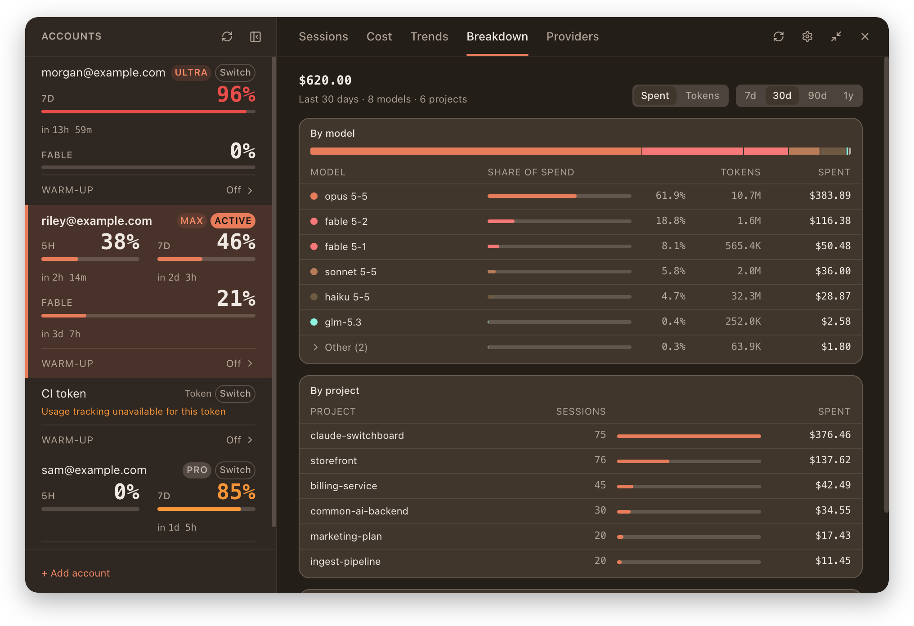

# Claude Switchboard

[](https://github.com/FeiXu-1131372/claude-switchboard/actions/workflows/test.yml)
[](https://github.com/FeiXu-1131372/claude-switchboard/releases/latest)
[](LICENSE)

**Know where you stand. Switch who's signed in. Run against any endpoint. Pick up where you left off. All from your menu bar.**

Switchboard is a menu-bar app for macOS and Windows that looks after your Claude rate limits, accounts, model providers and Claude Code session history. One glance shows what is left in the 5-hour, weekly and Fable limits. One click changes which account Claude Code uses, launches a session against another endpoint, or resumes a past session.

<p align="center">
  
</p>

<p align="center">
  <a href="https://github.com/FeiXu-1131372/claude-switchboard/releases/latest"><b>Download the latest release</b></a>
  &nbsp;·&nbsp; macOS (universal) and Windows 10/11
  &nbsp;·&nbsp; <a href="CHANGELOG.md">Changelog</a>
</p>

Every screenshot on this page is version 1.5.0 running on sample data.

---

## What's new in 1.5

- **A simpler window.** Five tabs instead of eight: Sessions, Cost, Trends, Breakdown and Providers.
- **One range for all the numbers.** Pick 7 days, 30 days, 90 days or a year once; Cost, Trends and Breakdown follow it and add up to the same total.
- **Fable limit.** The separate weekly Fable cap sits beside 5H and 7D in the popover, on every account row, and in the tray tooltip.
- **Ultra plan.** Ultra has no 5-hour window, so its accounts show the weekly bar at full width.
- **Five colour themes**, each in light and dark.
- **Automatic account rotation** now counts the Fable limit and can switch to an account that has no 5-hour window.

The full list is in the [changelog](CHANGELOG.md).

---

## Glance, don't query

**Your usage stays in the corner of your eye.**

A ring around the menu-bar icon shows the live percentage. Hover for a one-line summary, or click for the popover.

<p align="center">
  
  &nbsp;&nbsp;
  
</p>

The popover answers "can I keep coding?" in under a second.

<p align="center">
  
</p>

- **5H and 7D** with the time until each resets (`in 2h 14m`), so there is no arithmetic to do.
- **Fable** beside them when the account has the separate Fable weekly cap. A dot marks the limit your current model counts against.
- **Burn-rate projection.** `→ ~58% by reset` extrapolates from your current pace.
- **Details**, when your plan reports them: the Opus and Sonnet weekly split and pay-as-you-go credits.

<p align="center">
  
</p>

---

## Every account in one list

**Add as many Claude accounts as you have. Each row shows its own live usage, so you can see which one has room before you switch.**

<p align="center">
  
</p>

Plan badges (`PRO`, `MAX`, `ULTRA`) come from Anthropic on every poll, so an upgrade shows up within one tick. The limits each row shows depend on the plan: Ultra has no 5-hour window, and Fable appears only where the account has that cap. The list is the sidebar of the expanded window and a screen of its own in the popover.

### Switch without restarting Claude Code

**One click rewrites the stored credentials. Running CLI and VS Code sessions pick up the new account within about 30 seconds.**

<p align="center">
  
</p>

The dialog says what is about to change: which account new `claude` runs will use, how many running sessions will adopt it, and that your stored credentials and `~/.claude.json` are rewritten. On macOS the credentials live in the Keychain; on Windows, in Claude Code's credential file.

A 60-second guard covers the narrow race where a Claude Code process began refreshing its login just before the swap, so the swap is not silently overwritten.

### Automatic account rotation

In **Settings → Account rotation**, turn on automatic rotation and click **Save**. Switchboard then switches for you when the active account reaches **96% of its 5-hour limit or 98% of its weekly limit**. Both thresholds are adjustable, and the weekly threshold also applies to the Fable limit on accounts that have one.

<p align="center">
  
</p>

- **Which account it picks.** The one with the most headroom across its limits, or your preferred next account when that one is available. An account with no 5-hour window (Ultra, or one whose window has not started) counts as unused on that limit.
- **Which accounts it skips.** Any with a missing, stale or failed usage reading, and any with a limit already at its threshold. If none qualifies, Switchboard waits for fresh usage.
- **When it runs.** In the background while Switchboard is open, including with the popover hidden, with at least 60 seconds between switches. A successful switch sends a desktop notification, and Settings shows the latest result.

---

## Start your 5-hour window when you want it

**A one-token ping at 8am gives you a window that resets at 1pm, in step with your working day.**

<p align="center">
  
</p>

A warm-up asks Claude Code to send a one-word "hi" to Haiku with the account's own credentials, which opens a fresh 5-hour window for a tiny amount of usage. It runs Claude Code headless in a throwaway empty folder, so it reads none of your settings and leaves nothing in your session history; if Claude Code isn't installed, a one-token request goes to the API directly. If the account already has an active window, nothing is sent. If the API refuses the warm-up, the account row says why (the status and request id) instead of calling it a rate limit, and **Warm up now** / **Try again** always tries again: only the automatic schedule waits out a retry back-off.

Warm-up is **off by default and opt-in per account**, with a consent dialog the first time you enable it. Three schedules:

- **Off**: manual only, with the **Warm up now** button.
- **Every 5h**: pick an anchor such as 06:00 and it fires at 06:00, 11:00, 16:00 and 21:00.
- **Custom**: your own list of times.

Schedules can run with the app closed. See [Warm-up in the background](#warm-up-in-the-background).

---

## Pick up where you left off

**Every past Claude Code session, with its own recap, one click from resuming.**

<p align="center">
  
</p>

Sessions are searchable across titles, recaps, touched files and branches. Sort them, filter by project, model or time, show only sessions with a recap or only resumable ones, and group them by project with each group's cost.

<p align="center">
  
</p>

Open a row for Claude Code's own end-of-session recap: what you asked, where you left off, which files it touched, peak context use, and the permission mode Resume will re-apply.

- **Resume in a terminal**, which carries the provider's CLI flags and the session's permission mode.
- **Resume as a Claude Code tab in VS Code**, which carries the provider's credentials but not the flags or the mode, because the extension builds its own command line. The app tells you so.
- **Always a fork.** Resuming uses `--fork-session`, so a session still open elsewhere is never disturbed. If the project folder is gone, Resume is disabled and says why.

---

## See where it went

**Cost, Trends and Breakdown share one range. Pick 7 days, 30 days, 90 days or a year once, and the three tabs add up to the same total.**

The numbers come from your local Claude Code transcripts, priced per model, including the 1M-context tier and the 5-minute and 1-hour cache writes.

<p align="center">
  
</p>

**Cost** lists sessions by day with each day's total, and folds subagent runs into the conversation that started them.

<p align="center">
  
</p>

**Trends** charts spend or tokens by day or by week. Click a bar for that day's breakdown per model. Below the chart, an activity calendar covers the last 26 weeks.

<p align="center">
  
</p>

**Breakdown** answers "where did it go?" on one page: spend or tokens by model, by project, and what the prompt cache saved.

---

## Point Claude Code at any endpoint

**Run Claude Code against GLM, Kimi, DeepSeek, MiniMax, OpenRouter or your own endpoint, one session at a time, without touching your shell.**

<p align="center">
  
</p>

- **Add a provider** from a preset (GLM, Kimi, DeepSeek, MiniMax, OpenRouter) or a custom base URL. A preset pins every `/model` alias and the context-window settings, because an alias left unset would resolve to an Anthropic model the endpoint cannot serve.
- **Launch** opens a terminal with that provider's credentials for that one session. Nothing global changes, so several providers can run side by side, and your own launch scripts keep working.
- **Set default** makes a provider the default for bare `claude` runs. This writes `~/.claude/settings.json`: Switchboard backs the file up first, asks before overwriting any `ANTHROPIC_*` key it did not write, and restores your values when you turn it off.

Which terminal opens is a preference in Settings, limited to the terminals you have installed.

---

## Make it yours

**Five colour themes, each in light and dark: Terracotta, Graphite, Tide, Moss and Plum.**

<p align="center">
  
</p>

A theme sets the surface tint and the accent. Warning and danger colours are the same in every theme, so amber and red always mean the same thing. Choose the mode (light, dark, or follow the system) and the colour in **Settings → Appearance**.

<p align="center">
  
</p>

<p align="center">
  
</p>

---

## Add an account in two clicks

Three ways in:

1. **Use Claude Code's current login.** If `claude` is already signed in, import that account as it is.
2. **Sign in with another account.** Switchboard opens Anthropic's sign-in page in your browser and waits for you to approve.
3. **Import a long-lived token.** Paste a token from `claude setup-token` into the masked field, with an optional label. No browser and no running Claude Code are needed.

<p align="center">
  
</p>

Adding an account does not change which one Claude Code uses. Click **Switch** when you are ready. More in [Accounts and tokens](#accounts-and-tokens).

---

## Also on Windows

**Same layout, same interactions, same design. Mica on Windows 11, a translucent fallback on Windows 10.**

<p align="center">
  
  &nbsp;&nbsp;
  
</p>

On Windows, background warm-up is fully verified (see below), and [live usage from the status line](#live-usage-from-claude-codes-status-line) works with the shells Claude Code uses there (Git Bash or PowerShell).

---

## Why Switchboard

| | Switchboard | Read-only usage viewers |
|---|---|---|
| **At a glance** | Ring in the menu bar, popover one click away | Open an app to find out |
| **Accounts** | Any number, each with live usage | One account, or a static list |
| **Switching** | Rewrites stored credentials; sessions adopt in about 30s; can rotate automatically | Sign out and restart Claude Code |
| **5-hour window** | Warm-up starts it on your schedule | Starts at your first prompt |
| **Cost** | Per-model pricing with the 1M-context tier and both cache-write rates | Often approximated |
| **Other endpoints** | Per-session launch against third-party providers, or a global default | Not supported |
| **Sessions** | Past sessions with recaps; resume in a terminal or VS Code, always forked | Not supported |
| **Platforms** | macOS and Windows 10/11, same design | Usually macOS only |
| **Privacy** | Local only, no telemetry | Varies |

---

## Install

**[Download the latest release](https://github.com/FeiXu-1131372/claude-switchboard/releases/latest)**: a universal `.dmg` for macOS and an `.exe` installer for Windows.

The app is not notarized (there is no Apple Developer ID or Windows EV certificate behind it), so the first launch on a new machine needs one extra step:

- **macOS:** right-click the app in Finder and choose Open, or run `xattr -d com.apple.quarantine "/Applications/Claude Switchboard.app"`.
- **Windows:** in SmartScreen, choose "More info", then "Run anyway". Windows 10 needs WebView2; Windows 11 ships with it.

After that, updates install themselves.

Found a bug or want a feature? [Open an issue](https://github.com/FeiXu-1131372/claude-switchboard/issues/new).

### Updates

Switchboard checks for a new version on launch and every 6 hours while running. When one is downloaded, a banner at the top of the popover offers **Install & restart**. You can also check by hand from the popover footer or the tray menu.

Every release is signed with the project's ed25519 updater key, and the app refuses an update whose signature does not match the public key built into it.

Upgrading from v0.1.x? That build has no updater, so install a current release by hand once.

### Build from source

```bash
pnpm install
pnpm tauri dev
```

---

## Reference

### Accounts and tokens

Each account lives in its own slot with its own polled usage. Managed credentials are stored locally in `accounts.json`. Switching writes the chosen credentials to the macOS Keychain or to Claude Code's credential file on Windows. Switchboard sends these tokens only to Anthropic's official API, for profile checks, usage polling and opt-in warm-ups. A warm-up also hands the account's token to a local Claude Code process through its environment, never through a file, and that process talks only to Anthropic.

**Long-lived tokens have limits.**

- A token without profile permission cannot reveal an email, an account ID or usage limits. Such an account appears as **Token account N** (or your label) with usage marked unavailable. Turn on [live usage](#live-usage-from-claude-codes-status-line) to see it.
- The token does not reveal when it expires, so the expiry is shown as unknown.
- There is no refresh token. Use **Replace token…** in the account's menu when it stops working, after switching to another account first.

Keep tokens private: anyone holding one can spend the account's quota. An imported token is not a new subscription or a separate quota, and removing an account from Switchboard does not revoke its token with Anthropic.

### Live usage from Claude Code's status line

Accounts added with a long-lived token cannot read their usage from Anthropic's API, but Claude Code knows it and passes it to your status line. This option listens there.

**Turn it on:** Settings → Polling → **Live usage from Claude Code**. Switchboard first runs your status line once with sample data to prove nothing breaks, then shows exactly what it will change and waits for **Turn on**. The only edit is `statusLine.command` in your Claude Code `settings.json`, which will run Switchboard's bridge. The bridge runs your original command, shows its output and returns its exit code, so your status line looks and behaves as before.

**What it records:** the 5-hour and 7-day percentages, their reset times, and the signed-in account's ID, in `~/.claude-switchboard/statusline/`. Nothing leaves your computer.

**Which sessions report:** interactive Claude Code sessions in the CLI. These keep using normal polling instead: sessions started with a `CLAUDE_CODE_OAUTH_TOKEN` environment variable, non-interactive runs (`-p`, the Agent SDK), IDE sessions, WSL and remote hosts, projects that set their own `statusLine`, and sessions with `disableAllHooks` on. Accounts that can poll keep polling; the status line is used only when it is fresher or polling is rate-limited.

**After a switch:** Claude Code can report the previous account's numbers for a moment, so Switchboard waits 30 seconds for fresh data and never applies a reading to an account it cannot match.

**Turn it off:** flip the switch. `settings.json` goes back exactly as it was, even if other keys changed in the meantime. If someone else changed the command, Switchboard leaves it alone and says so. Without the app, run:

```bash
~/.claude-switchboard/statusline/bridge --restore --all
```

A copy of the file from before the first change is kept beside it as `settings.json.switchboard-statusline-anchor`.

**Platform:** macOS and Windows. On Windows, Claude Code runs a status line in Git Bash or PowerShell, depending on what is installed. Before changing anything, Switchboard runs the bridge in every shell it could pick and uses the first spelling of the bridge's path that all of them accept; if any shell cannot run it, nothing is changed and the consent panel names that shell. The bridge is tested on Windows 11 in Git Bash, PowerShell 7 and Windows PowerShell 5.1. Not tested: a PC with neither Git nor PowerShell 7, non-UTF-8 code pages such as cp936, and locked-down machines (AppLocker, WDAC).

On Windows, uninstalling Switchboard does not undo the edit. The bridge keeps showing your original status line, and stops recording usage after 30 days without the app. To put your status line back without Switchboard, run this in PowerShell:

```powershell
& "$env:USERPROFILE\.claude-switchboard\statusline\bridge.exe" --restore --all
```

or this in Command Prompt: `"%USERPROFILE%\.claude-switchboard\statusline\bridge.exe" --restore --all`.

### Warm-up in the background

Turn on **Settings → Warm-up → Enable in background** to let schedules fire with the app closed, through launchd on macOS and Task Scheduler on Windows. Without it, schedules still fire while the app is open.

- **On Windows** the task runs once a minute as your signed-in user, without opening a console, including on battery. It runs while the computer is awake, and after sleep or a restart it catches up the latest missed schedule from the past 24 hours. It does not wake a sleeping computer.
- **Handled once.** The app and the background task share their records, so a scheduled warm-up fires once even when both are running. Both check your consent and the account's toggle, and skip an account that already has an active window.
- **Retries.** Network and server failures retry after five minutes. Authentication and rate-limit failures wait thirty.
- **What happened.** Settings shows each account's next scheduled check, its last successful warm-up, and the most recent result or error.

From a terminal, `claude-switchboard --register-scheduler` registers the current executable and `claude-switchboard --tick` runs one background check (`--tick --data-dir <directory>` uses a separate data directory).

Background warm-up has been verified on Windows. macOS uses the same runner through its LaunchAgent, but a closed-app test including Keychain access is still to be done there.

### Migrating from Claude Limits (v0.3.x)

Install Switchboard and launch it once. It will:

1. Find your v0.3.x data at `~/Library/Application Support/com.claude-limits.ClaudeLimits/`.
2. Quit any running Claude Limits process.
3. Copy your usage history, accounts and settings to the new directory.
4. Move the launch-at-login entry, if you had one, to the new app.
5. Show a one-time summary of what moved.

Your old install is left in place, so you can still open `Claude Limits.app`.

---

## Privacy

- **Everything stays on your machine.** Usage history is in SQLite at `~/Library/Application Support/com.claude-switchboard.ClaudeSwitchboard/data.db` on macOS, or the equivalent on Windows.
- **No telemetry and no analytics.**
- **Outbound traffic goes to Anthropic's official API only**, unless you add a third-party provider.
- **Third-party providers are third parties.** A session launched against one sends your prompts to that provider's endpoint, not to Anthropic. Switchboard stores the API key you give it locally and sends it only to that endpoint.
- **Setting a default provider writes one file**, `~/.claude/settings.json`, with a backup and an undo record.
- **Live usage edits one setting**, `statusLine.command`, after a consent screen, and restores it exactly when turned off.
- **Warm-up is opt-in.** With your consent per account, Switchboard starts the 5-hour window by having Claude Code (or, if it isn't installed, the API directly) send a one-word message to Haiku. Nothing else is ever sent, and you can revoke it at any time.

## Stack

Tauri v2 (Rust and WebView) · React 19 · TypeScript · Tailwind CSS v4 · Framer Motion · Recharts · Zustand · lucide-react · SQLite.

## Development

```bash
# Frontend typecheck
pnpm exec tsc --noEmit

# Frontend tests (Vitest)
pnpm test

# Backend tests (Rust unit and integration)
cd src-tauri && cargo test

# The real UI in a browser, on sample data
pnpm preview:ui   # http://localhost:1430/preview.html
```

The screenshots on this page are taken from that preview at `?scale=demo` by the scripts in [`scripts/readme-screenshots`](scripts/readme-screenshots).

## License

MIT
