# Claude Switchboard

[](https://github.com/FeiXu-1131372/claude-switchboard/actions/workflows/test.yml)
[](https://github.com/FeiXu-1131372/claude-switchboard/releases/latest)
[](LICENSE)

**Know where you stand. Switch who's signed in. Run against any endpoint. Pick up where you left off. All from your menu bar.**

Switchboard is a native menu-bar control plane for your Claude rate limits, accounts, model providers, and session history. One glance tells you what's left in the 5-hour and 7-day windows — or just the weekly window on Ultra. One click swaps which account Claude Code is using, launches a session against a third-party endpoint, or resumes a past session. One toggle starts a fresh 5-hour bucket on your schedule, not whenever you happened to fire your first prompt.

<p align="center">
  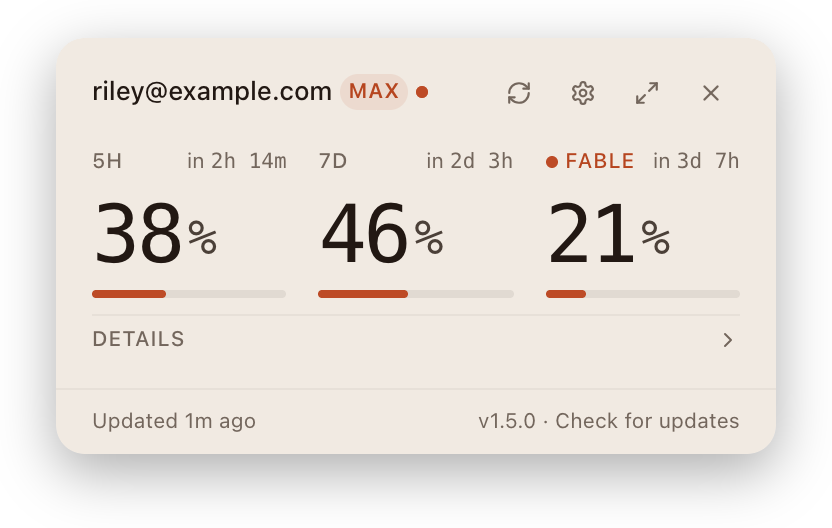
</p>

---

## Glance, don't query

**Your 5-hour utilization stays in peripheral vision.**

A ring around the menu-bar icon shows live percentage. Hover for a one-line summary; click for the popover. No window to open, no command to run.

<p align="center">
  
  &nbsp;&nbsp;
  
</p>

The compact popover gives you everything you need to decide "can I keep coding?" in under a second:

- **5H / 7D bars** with absolute reset times (`in 19m`, `in 46h 9m`) — never math-on-the-fly
- **Fable beside them** when your account has the separate Fable weekly cap
- **Burn-rate projection** — `→ ~26% by reset` extrapolates from your current pace
- **Details disclosure** — expand for the Opus/Sonnet weekly split and pay-as-you-go credits. It appears only when your plan reports them (Pro and Team-Pro share a single combined 7-day quota, so the model rows don't apply there)

<p align="center">
  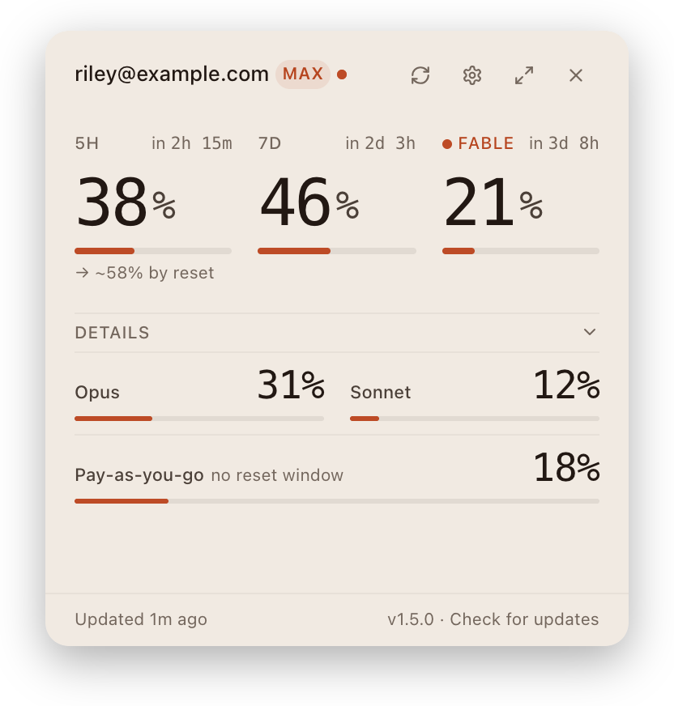
</p>

---

## One menu, every account

**Manage as many Claude accounts as you have. See them all stacked, ranked by tier, with the active one highlighted.**

<p align="center">
  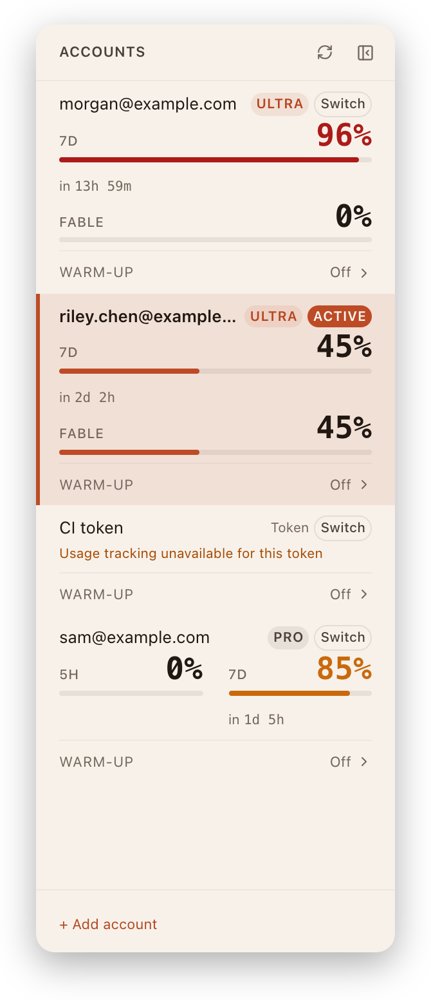
</p>

Every account row carries its own polled usage — so before you switch, you can see which account has runway. The active account is highlighted in warm orange; tier badges (`MAX`, `PRO`) are pulled live from Anthropic on every poll, so a plan upgrade is reflected within one tick.

---

## Switch who's signed in — without restarting Claude Code

**One click rewrites the OS-level credentials. Running CLI and VS Code sessions adopt the new account within ~30 seconds.**

<p align="center">
  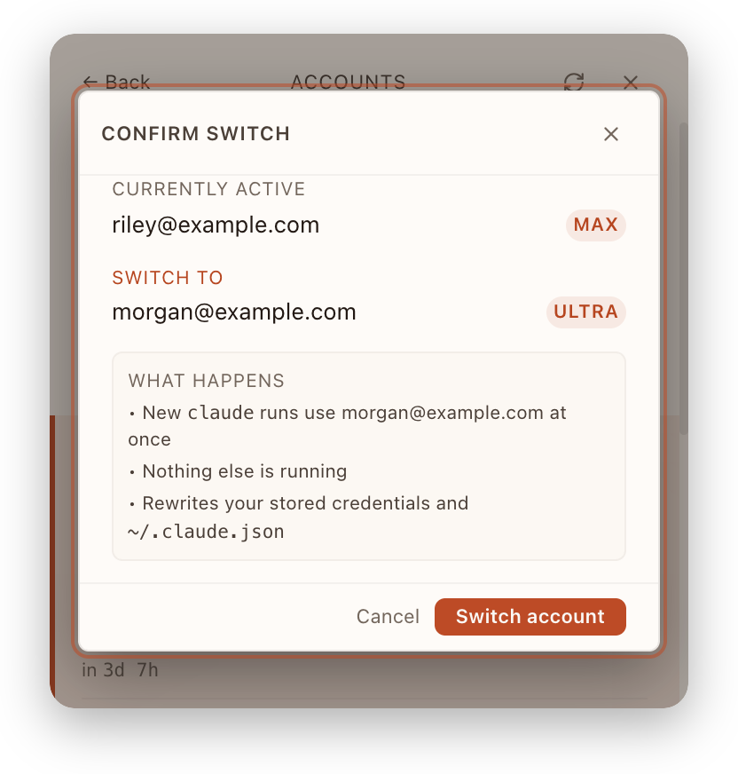
</p>

The confirm dialog tells you exactly what's about to change — Keychain entry, `~/.claude.json` slice, which account new `claude` invocations will use, and how long running sessions take to pick up the swap. No mystery, no manual file editing.

A 60-second `KeychainGuardian` covers the narrow race where a Claude Code process started its OAuth refresh just before the swap, so the swap can't be silently overwritten.

### Automatic account rotation

In **Settings → Account rotation**, enable automatic rotation and click **Save**.
By default, Switchboard switches when the active account reaches **96% of its
5-hour limit or 98% of its weekly limit**. Both thresholds are adjustable. The
weekly threshold also applies to the separate Fable weekly limit, on accounts
that have one.

Automatic selection chooses the account with the most headroom across its
limits. An account with no 5-hour window (Ultra, or one whose window has not
started) counts as unused on that limit. You can select a preferred next account; if it is active or unavailable,
automatic selection supplies the fallback. Accounts with missing, stale, invalid,
or failed usage readings, or any limit already at its threshold, are skipped.
If no account qualifies, Switchboard waits for refreshed usage. Settings show
the latest rotation result, and successful switches send a desktop notification.

Rotation runs in the Rust backend while Switchboard is open, including while
the popover is hidden. It uses the existing usage polling and live statusline
data, respects API backoff, and waits at least 60 seconds between switches.
Running Claude Code sessions usually adopt the new account within about 30 seconds.

---

## Start your 5-hour window when *you* want it

**A 1-token Haiku ping at 8am gives you a window that resets at 1pm — aligned to your workday instead of trailing into the evening.**

<p align="center">
  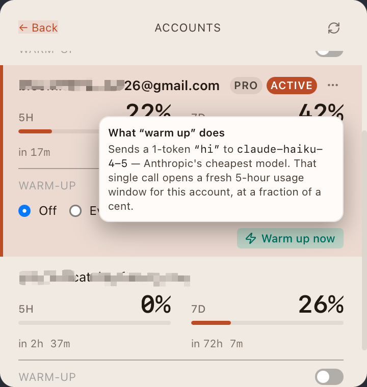
</p>

Warm-up is **strictly opt-in** per account, with a one-time consent dialog the first time you enable it on any account. Cost is rounding-error against your subscription (≈$0.0000007 per fire, ≈$0.0013/year on a 5-fires-a-day cadence). If the account already has an active 5-hour window from your normal coding, warm-up is a no-op — it skips the HTTP call entirely.

<p align="center">
  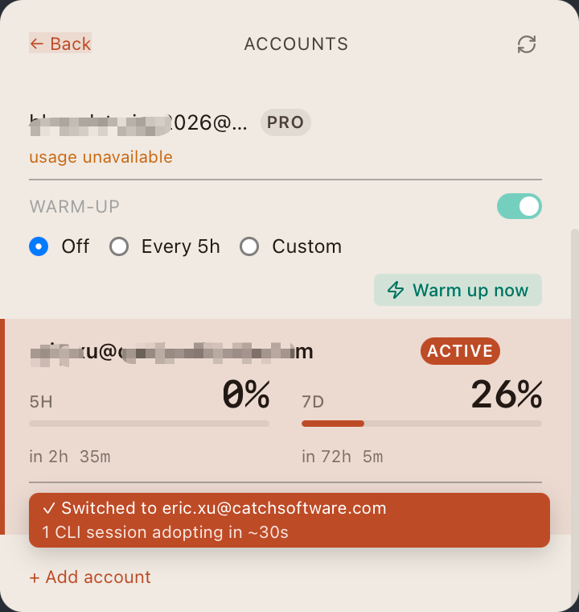
</p>

Three preset shapes:

- **Off** — manual only.
- **Every 5h** — pick an anchor (e.g. 06:00) and the app fires at 06:00, 11:00, 16:00, 21:00.
- **Custom** — explicit list of `HH:MM` times.

Schedules fire via the OS (launchd on macOS, Task Scheduler on Windows) so they work even when the app is closed. Prefer not to register an OS agent? The in-app scheduler still fires while the app is open.

Enable **Settings → Warm-up → Enable in background** to register background
checks. On Windows, the task runs once per minute as your signed-in user,
including on battery power, without opening a console. It runs while the
computer is awake and catches up the latest missed schedule from the past
24 hours after sleep or restart. It does not wake a sleeping computer.

The app and background task share persisted claims, so a scheduled occurrence
is handled once even when both are running. They check global consent and the
account's warm-up toggle, skip existing five-hour windows using saved usage,
and retain retry delays across restarts. Network/server failures retry after
five minutes; HTTP authentication and rate-limit failures wait thirty minutes.
Settings show each account's next scheduled check, last successful warm-up,
and most recent result or error.

For local installations, `claude-switchboard --register-scheduler` registers
the current executable. `claude-switchboard --tick` runs one background check;
`--tick --data-dir <directory>` selects an explicit data directory for isolated
checks. Starting the app refreshes an existing registration to its current
executable location.

Background execution has been verified on Windows. macOS uses the same runner
through its LaunchAgent, but a closed-app smoke test, including Keychain access,
is still needed there.

---

## Point Claude Code at any endpoint

**Run Claude Code against GLM, Kimi, DeepSeek, MiniMax, OpenRouter, or your own endpoint — one session at a time, without touching your shell.**

<p align="center">
  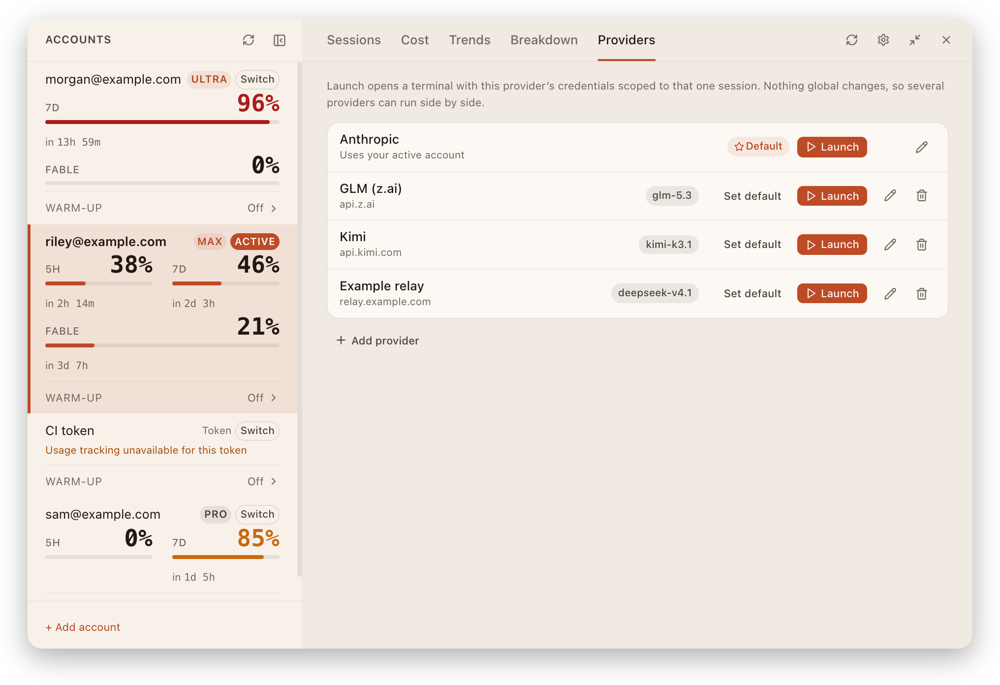
</p>

Add a provider from a preset — GLM (z.ai), Kimi, DeepSeek, MiniMax, OpenRouter — or point it at a custom base URL. Every preset pins *all* the `/model` aliases and the context-window knobs, because an unset alias resolves to a first-party Anthropic id the endpoint cannot serve.

<p align="center">
  
</p>

"Launch opens a terminal with this provider's credentials scoped to that one session. Nothing global changes, so several providers can run side by side" — and your own launch scripts keep working alongside it, since everything is per-process environment variables, never a global rewrite.

A provider can also be set as the **default** for bare `claude` invocations. Turning that on writes `~/.claude/settings.json` — Switchboard backs the file up first, records an undo manifest, and asks before overwriting any `ANTHROPIC_*` keys it didn't write. Turning it off restores your values and tells you which of your own edits it deliberately left alone. Which terminal launches (and which app, on Windows) is a preference in Settings, scoped to whichever terminals are actually installed.

---

## Pick up where you left off

**Every past Claude Code session, with its own end-of-session recap, one click from resuming.**

<p align="center">
  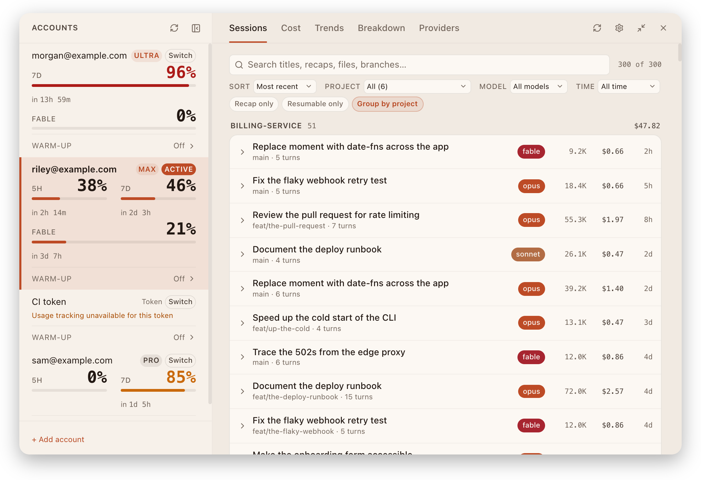
</p>

Sessions are grouped by project, newest first, and searchable across titles, recaps, and touched files. Expand any row for Claude Code's own end-of-session recap — what you asked, where you left off, which files it touched, peak context usage with a fill bar, and the permission mode Resume will re-apply.

<p align="center">
  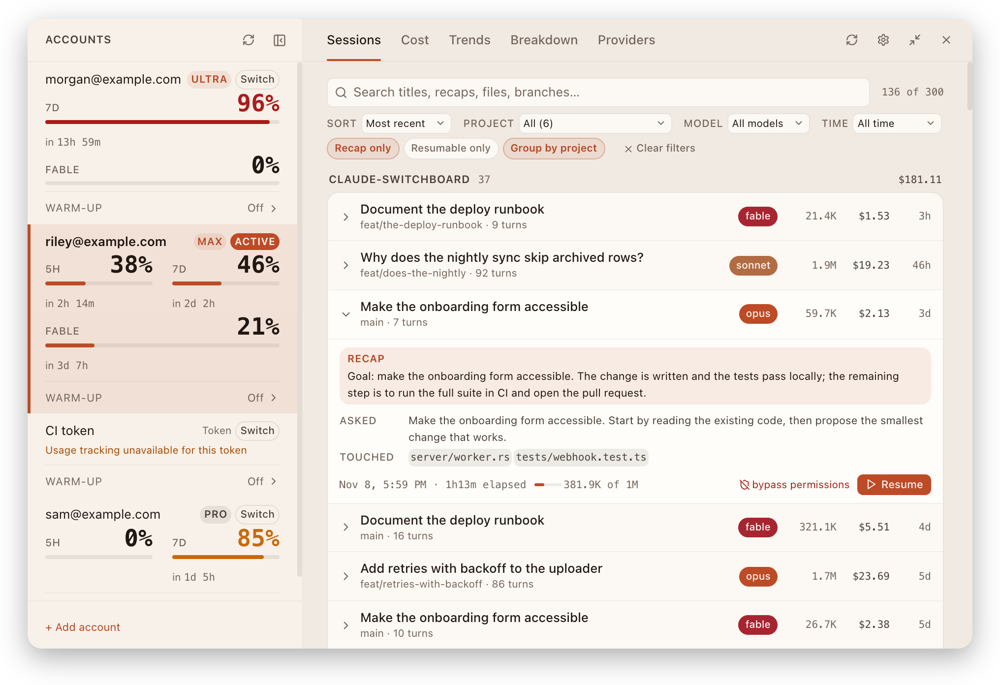
</p>

Resume in a terminal, or as a Claude Code tab in a new VS Code window. The terminal path carries the provider's CLI flags and the session's permission mode; a VS Code tab carries the provider's credentials but not the flags or the mode — the extension builds its own argv, and the app says so rather than letting a `bypassPermissions` session come back up asking for permission with no explanation.

<p align="center">
  
</p>

Resuming always forks (`--fork-session`), so a session still open elsewhere is never disturbed. If the project folder is gone, Resume is disabled with a reason instead of failing silently.

---

## Onboard in seconds

**Import the account `claude` is already signed into, or sign in fresh — either way, two clicks.**

<p align="center">
  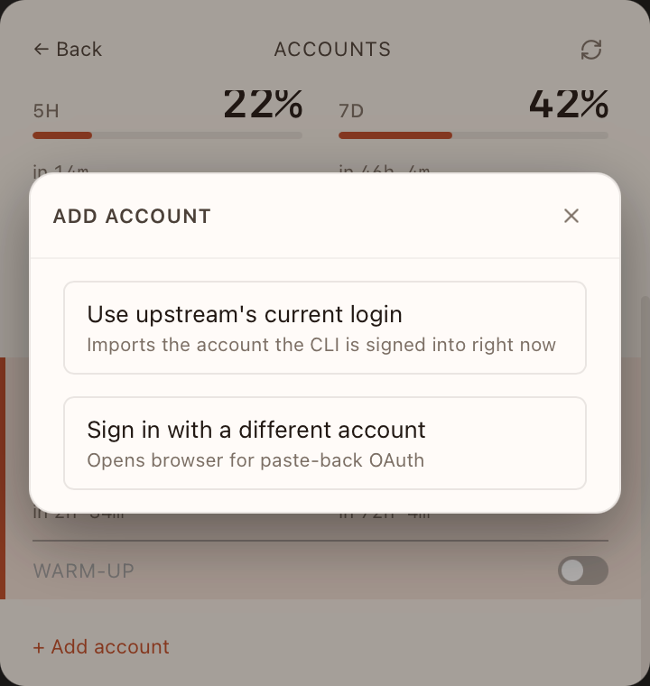
</p>

For accounts you haven't logged into with `claude` yet, Switchboard runs a standard OAuth flow with a local-redirect paste-back. The browser handles the Anthropic consent screen; the app waits.

<p align="center">
  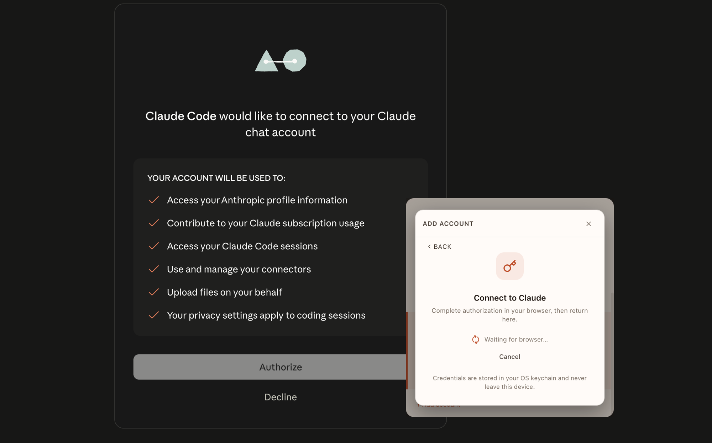
</p>

<p align="center">
  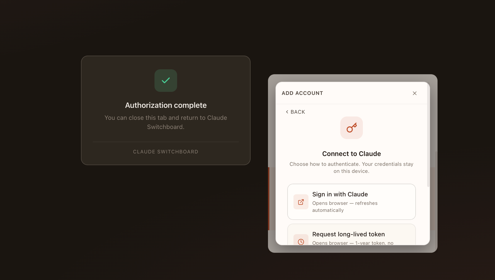
</p>

Already have a token from `claude setup-token`? Choose **Import long-lived token** and paste it into the masked field. An optional label helps you recognize it; no browser login, account metadata file, or running Claude Code process is required.

Managed credentials are stored locally in `accounts.json`. Switching writes the selected credentials to the macOS Keychain or Windows Claude Code credential file. Switchboard sends these OAuth tokens only to Anthropic's official API for profile checks, usage polling, and opt-in warm-ups.

---

## Cost, Trends and Breakdown

**The token/cost tab from earlier versions is now called Cost — Sessions now means the session browser above.** Cost, Trends and Breakdown share one range (7 days, 30 days, 90 days or a year): pick it once and all three follow, and they add up to the same total.

<p align="center">
  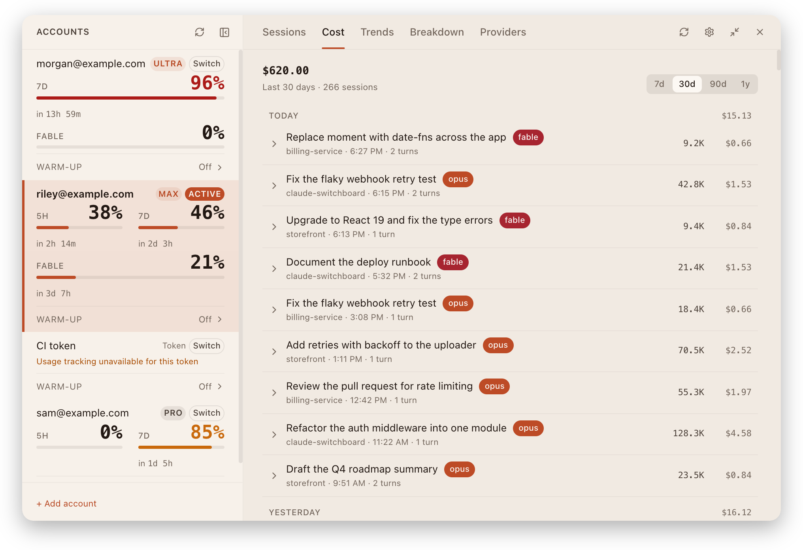
</p>

Cost groups sessions by day with each day's total, rolls subagent runs into their parent conversation, and visually demotes headless or scheduled runs instead of showing a broken-looking blank row.

<p align="center">
  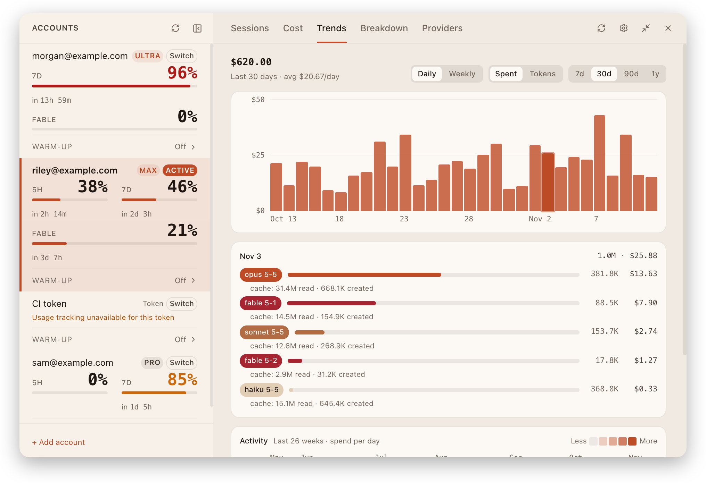
</p>

Trends charts your usage over time, by day or by week — click any bar to see its per-model token, cost, and cache breakdown, sorted by cost. The whole window loads with the chart, so opening a day is instant. Below the chart, an activity calendar shows the last 26 weeks at a glance.

Breakdown answers "where did it go?" on one page: spend or tokens by model, by project, and what the prompt cache saved. It replaces the separate Models, Projects and Cache tabs.

---

## Also on Windows

**Same layout, same interactions, same design language. Rendered with Mica on Windows 11 and a translucent fallback on Windows 10.**

<p align="center">
  
  &nbsp;&nbsp;
  
</p>

<p align="center">
  
</p>

The full report has five tabs — Sessions, Cost, Trends, Breakdown, Providers — sourced from your local Claude Code JSONL transcripts. (The two screenshots below are from an earlier version, when Models and Heatmap were tabs of their own; they are now part of Breakdown and Trends.)

<p align="center">
  
</p>

<p align="center">
  
</p>

---

## Why this and not the other tools

| | Switchboard | Read-only usage viewers |
|---|---|---|
| **Glance value** | Ring badge in the menu bar | Open an app to find out |
| **Multi-account** | First-class, with one-click swap | Single-account or static list |
| **Account switching** | Rewrites OS creds; sessions adopt in ~30s | Not supported — restart Claude Code |
| **Window control** | Warm-up to start the 5H bucket on your schedule | None — bucket starts at first prompt |
| **Tier-aware cost** | Sonnet 4 1M-context tier + 5m/1h cache writes calculated correctly | Often approximated |
| **Cross-platform** | macOS + Windows 10/11, same design | Usually macOS-only |
| **Privacy** | Local-only. No telemetry. | Varies |
| **Third-party endpoints** | Per-session launch against GLM/Kimi/DeepSeek/MiniMax/OpenRouter, or a global default | Not supported |
| **Session resume** | Past sessions with recaps; resume into a terminal or a VS Code tab, always forked | Not supported |

---

## Features at a glance

- **Live tray badge** — 5-hour percentage as a ring around the menu-bar icon
- **Multi-account, one-click swap** — every account in one popover, click to switch, running sessions adopt in ~30s
- **Burn-rate projection** — extrapolates your pace and color-cues against your threshold
- **Threshold notifications** — warn / danger levels you choose; one alert per bucket cycle
- **Five-tab expanded report** — Sessions, Cost, Trends, Breakdown, Providers, with one shared range
- **Five colour themes** — Terracotta, Graphite, Tide, Moss and Plum, each in light and dark
- **Tier-aware cost math** — Sonnet 4's 1M-context tier and the 5-minute / 1-hour cache write split
- **Custom model providers** — launch Claude Code against GLM, Kimi, DeepSeek, MiniMax, OpenRouter, or a custom endpoint, per-session or as a global default
- **Session browser + resume** — every past session with its own recap, one click from resuming into a terminal or a VS Code tab, always forked
- **Trends day breakdown** — click any day for its per-model token, cost, and cache split
- **Warm-up & scheduling** — manual or OS-scheduled, strictly opt-in, ~$0.013/account/year
- **Auto-update** — checks every 6h, signed with ed25519, single-click install
- **Cross-platform** — macOS (vibrancy) and Windows 10/11 (Mica / acrylic)

---

## Install

**[⬇ Download the latest release](https://github.com/FeiXu-1131372/claude-switchboard/releases/latest)** — macOS `.dmg` (universal) and Windows `.exe`.

The app is not notarized (no Apple Developer ID / Windows EV certificate), so the *first* launch on a new machine needs one extra step:

- **macOS:** right-click → Open from Finder, or `xattr -d com.apple.quarantine "/Applications/Claude Switchboard.app"`
- **Windows:** SmartScreen → "More info" → "Run anyway". WebView2 is required on Windows 10 (Windows 11 ships it).

After that, updates install themselves — see [Updates](#updates).

Found a bug or want a feature? [Open an issue](https://github.com/FeiXu-1131372/claude-switchboard/issues/new).

### Build from source

```bash
pnpm install
pnpm tauri dev
```

## Updates

Switchboard checks for new versions automatically — on launch and every 6 hours while running. When an update is downloaded and ready, a banner appears at the top of the popover with an **Install & restart** button. You can also trigger a check manually from the popover footer or the tray menu.

**Important:** Auto-update was added in **v0.2.0**. If you're upgrading from v0.1.x, download and install v0.2.0 manually from the [releases page](https://github.com/FeiXu-1131372/claude-switchboard/releases) — the v0.1.x build has no updater wired up. Every release after v0.2.0 auto-updates.

The app is unsigned (no Apple Developer ID / Windows EV cert), so the *first install* on a new machine goes through the OS-specific first-launch flow above. After that, updates are silent — Gatekeeper and SmartScreen don't re-check signed-by-the-same-developer apps on update.

Update integrity: every release artifact is signed with our ed25519 updater key, and the app refuses any update whose signature doesn't match the embedded public key.

## Authentication & multi-account

Switchboard manages as many Claude accounts as you have. Each account lives in its own slot with its own polled usage; the **Accounts** sub-screen shows all of them stacked, with the currently-active one highlighted. Every slot has a **Switch account** button — click it to make Claude Code (CLI and the VS Code extension) point at that account.

Three ways to add an account:

1. **Import the upstream login** — sign in with `claude login` first, then in Switchboard hit "Use upstream's current login". Captures the live credentials in one click.
2. **OAuth in-app** — opens a local-redirect OAuth flow. Useful for adding accounts you haven't logged into via `claude` yet.
3. **Import long-lived token** — paste the OAuth token produced by `claude setup-token`, optionally give it a label, then select **Add account**. Available on Windows and macOS, including first-run setup. Importing does not change the active Claude Code account; select **Switch account** separately when ready.

**Token-only limitations.** Switchboard checks the profile endpoint without making a model request. If profile permission is available, it uses the verified identity. Inference-only tokens cannot reveal an email, account UUID, or usage limits, so they appear as **Token account N** (or your label), with polled usage explicitly unavailable (turn on [live usage from Claude Code's status line](#live-usage-from-claude-codes-status-line) to see it). Switchboard does not invent an identity or mistake a missing profile scope for an expired login. The opaque token does not reveal its expiry, so imported expiry is shown as unknown rather than assumed to be one year from import. Imported tokens have no refresh token; use the account menu's **Replace token…** action when necessary. Switch to another account before replacing an active token.

Keep tokens private: anyone holding one can spend the account's quota. An imported token does not create a new subscription or separate quota. Removing an entry from Switchboard does not revoke the token with Anthropic. Existing browser sign-ins and duplicate accounts are not overwritten by token import.

**Hot reload, not restart.** A swap rewrites the OS-level credentials atomically — running Claude Code sessions pick up the new account within ~30 seconds (Claude Code's own keychain cache TTL on macOS, one API tick on Windows). A 60-second `KeychainGuardian` protects against the narrow race where a Claude Code process started its OAuth refresh just before the swap.

## Live usage from Claude Code's status line

Accounts added with a long-lived token (`claude setup-token`) can't read their usage from Anthropic's API, but Claude Code itself still knows it and passes it to your status line. This option listens there.

**Turn it on:** Settings → Polling → **Live usage from Claude Code**. Switchboard first runs your status line once with sample data to prove nothing breaks, then shows exactly what it will change and waits for **Turn on**. The only edit is `statusLine.command` in your Claude Code `settings.json`, which will run Switchboard's bridge. The bridge runs your original command, shows its output, and exits with its exit code, so your status line looks and behaves as before. If you had none, Claude Code hides its built-in footer hint while this is on, because it now has a status line.

**What it records:** the 5-hour and 7-day percentages, their reset times, and the signed-in account's ID, in `~/.claude-switchboard/statusline/`. Nothing leaves your computer.

**Which sessions report.** Interactive Claude Code sessions in the CLI. These keep using normal polling instead: sessions started with a `CLAUDE_CODE_OAUTH_TOKEN` environment variable (Claude Code never passes that variable on, so the account can't be identified), non-interactive runs (`-p`, the Agent SDK), IDE sessions, WSL and remote hosts, projects that set their own `statusLine`, and any session where `disableAllHooks` is on. Accounts that can poll keep polling; the status line is used only when it is fresher or polling is rate-limited.

**Account switches.** An observation is matched to an account by the identity it was recorded under. Right after a switch Claude Code can still report the previous account's numbers, so for the first 30 seconds Switchboard waits for fresh data, and it never applies a record to an account it can't match.

**Turn it off:** flip the switch. `settings.json` goes back exactly as it was, even if Claude Code or you edited other keys in the meantime; if the command was changed by someone else, Switchboard leaves it alone and says so. Without the app, run:

```bash
~/.claude-switchboard/statusline/bridge --restore --all
```

A copy of the file from before the first change is kept next to it as `settings.json.switchboard-statusline-anchor`.

**Platform.** macOS today. The Windows runtime (Git Bash and PowerShell resolution, the quoting, the process tree) is written to the same design but has not been run on Windows, so the switch is hidden there.

## Warm-up & scheduling

Switchboard can deliberately start an account's 5-hour rolling window so its reset time is known and predictable — useful when rotating across multiple accounts. **Off by default per account; strictly opt-in.**

The first time you enable warm-up on any account, a one-time consent dialog explains exactly what gets sent. Per-account toggle and global revoke are available in Settings at any time.

A warm-up sends a 1-token Haiku request to `api.anthropic.com/v1/messages` using the account's existing OAuth credentials — the same surface Claude Code uses. Cost is rounding-error against your subscription (≈$0.0000007 per fire, ≈$0.0013/year on a 5-fires-a-day cadence). If the account already has an active 5-hour window from your normal coding, warm-up is a no-op.

## Migrating from Claude Limits (v0.3.x)

If you previously used Claude Limits, install Switchboard from the releases page and launch it once. It will:

1. Detect your existing v0.3.x data directory at `~/Library/Application Support/com.claude-limits.ClaudeLimits/`.
2. Quit any running Claude Limits process.
3. Copy your usage history, accounts, and settings to the new directory.
4. Remove the legacy launch-at-login entry (if you had it enabled) and re-register under the new bundle ID.
5. Show a one-time welcome dialog summarizing what migrated.

Your old install is preserved — you can launch the legacy `Claude Limits.app` to fall back at any time. After ~3 months of stable Switchboard use, the app will offer a "tidy old data" button.

## Privacy

- All data stays on your machine. Usage history is in SQLite at `~/Library/Application Support/com.claude-switchboard.ClaudeSwitchboard/data.db` (macOS) or the platform equivalent on Windows.
- With no custom provider configured, the only outbound traffic is to Anthropic's official API.
- **Third-party providers are third parties.** When you launch a session against a custom provider, your prompts go to that provider's endpoint — `api.z.ai`, `api.kimi.com`, `api.deepseek.com`, `api.minimax.io`, `openrouter.ai`, or whatever base URL you enter — not to Anthropic. Switchboard stores the API key you give it locally alongside your usage database and sends it only to that endpoint.
- **Setting a global default writes one file.** Choosing a provider as the default for bare `claude` invocations writes `~/.claude/settings.json`. Switchboard backs the file up first, records an undo manifest, asks before overwriting `ANTHROPIC_*` keys it did not write, and on removal restores your values — telling you which of your own edits it deliberately left in place.
- **Live usage edits one setting.** Turning it on changes `statusLine.command` in your Claude Code `settings.json` (after a consent screen and a one-time anchor backup) and records usage percentages, reset times and your account ID under `~/.claude-switchboard/statusline/`. Turning it off restores the file exactly.
- No telemetry, no analytics — Switchboard itself never phones home.
- **Opt-in warm-up:** With your explicit per-account consent, Switchboard can send 1-token warm-up messages to `/v1/messages` to start the 5-hour window deliberately. No other content is ever sent. Off by default; revocable any time.

## Stack

Tauri v2 (Rust + WebView) · React 19 · TypeScript · Tailwind CSS v4 · Framer Motion · Recharts · Zustand · lucide-react · SQLite.

## Development

```bash
# Frontend typecheck
pnpm exec tsc --noEmit

# Frontend tests (Vitest)
pnpm test

# Backend tests (Rust unit + integration)
cd src-tauri && cargo test
```

## License

MIT
